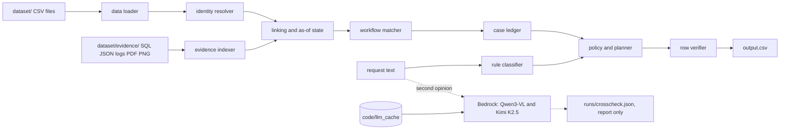
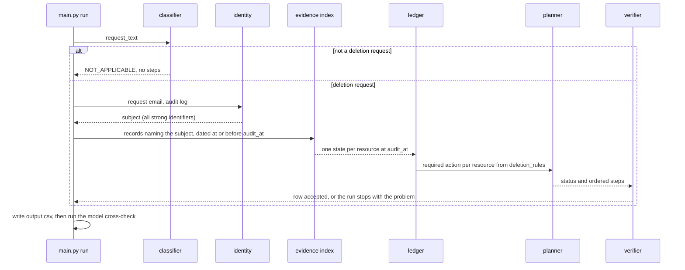

# Ghost Data Still Exists: a deletion-audit agent

### Decides which deletion requests are real, finds the personal data that is still there at the audit time, and writes the ordered fix and verification plan

HackerRank Orchestrate, October 2026. Command-line tool, no hosted service: there is no live URL or demo.

**Keywords:** deletion audit, data privacy, GDPR erasure, evidence reconstruction, deterministic pipeline, Amazon Bedrock, Python.

## Table of Contents

- [Overview](#overview)
- [Key Features](#key-features)
- [Tech Stack](#tech-stack)
- [System Architecture](#system-architecture)
- [Application Flow](#application-flow)
- [Data and Evaluation Pipeline](#data-and-evaluation-pipeline)
- [Results](#results)
- [Determinism Contract](#determinism-contract)
- [Deployment and Infrastructure](#deployment-and-infrastructure)
- [Project Structure](#project-structure)
- [Getting Started](#getting-started)
- [Usage](#usage)
- [Testing](#testing)
- [Roadmap](#roadmap)
- [Contributing, License, Contact](#contributing-license-contact)

## Overview

A commerce platform's deletion workflow can report COMPLETE while the person's data is still sitting in a search index, a support attachment, an export, an analytics record or a backup that can be restored. For each of the 518 requests this tool answers four questions:

1. Does the request text actually ask for deletion? (Access, correction, export and marketing opt-out do not.)
2. Who is the subject? It rebuilds the current and every historical email, phone, email hash and user id from the identity snapshot and the audit log.
3. What was the state of each of that person's records at `audit_at`, using only evidence dated at or before that time? Workflow statuses and activity results are treated as claims, not proof.
4. What does `deletion_rules.csv` require for each record, and what is the safe order to get there?

The output is `output.csv` with `case_id,deletion_status,steps_json`: findings with the evidence that proves them, the remediation plan, and the verification checks that must pass afterwards.

## Key Features

| Feature | What it does |
|---|---|
| Identity timelines | Links by email, email hash, phone and user id as they were at audit time. Names are weak and never link. |
| Temporal admissibility | A record or citation dated after `audit_at` cannot change or support an answer. |
| Absence is proved | A missing row counts as absent only when a snapshot scope covers it. |
| Multi-format evidence | SQL snapshots (through sqlite3), JSON, logs, text, PDFs (pdftotext) and screenshots (tesseract), 94 files indexed. |
| Policy engine | Delete, redact, anonymize, retain or preserve a tombstone, per `deletion_rules.csv`. |
| Ordered plan | Findings, then remediation (stop data flows and restores before changing records), then verification. |
| Row verifier | Every row is checked against the submission contract before the file is written. |
| Model cross-check | Two Bedrock models re-read every request; disagreements are reported and never applied. |
| Vision reader | Qwen3-VL reads PDFs and screenshots into a strict schema; benchmarked, not wired into the output. |

## Tech Stack

| Layer | Choice |
|---|---|
| Language | Python 3.10 or newer (tested on 3.13.7) |
| Evidence | `sqlite3`, `pdftotext` (poppler), `tesseract` |
| Models | Amazon Bedrock Converse API: `qwen.qwen3-vl-235b-a22b` (primary), `moonshotai.kimi-k2.5` (second reader) |
| Client | `boto3` 1.43.118 (only needed for a cache miss) |
| Tests | `pytest` |
| Cost | Under 0.3 USD for the whole final run; no containers, no hosted infrastructure |

## System Architecture



Everything on the solid path is plain deterministic Python. The models sit on the dotted side path: they re-read the request text and can only produce a report, so no model output can reach `output.csv`. Their answers are cached at temperature 0 in `code/llm_cache`, which ships with the code.

## Application Flow



## Data and Evaluation Pipeline

1. **Sources.** Only `dataset/`: 518 requests, 32 public samples with reference answers, identity snapshot, audit log, global system activity, deletion rules, and the 94 evidence files listed in `evidence_files.csv`.
2. **Cleaning.** Timestamps become UTC; emails are NFKC-normalised and case-folded; phones keep digits; email hashes are checked against sha256 of the email. OCR text is matched tolerantly, and a repaired email is used only when it resolves to a known identifier.
3. **Transformation.** Each evidence file becomes records with file id, capture time, record time, system, resource id and identifiers. Each record becomes an observation of one resource's state (PRESENT, ABSENT, IDENTIFIABLE, ANONYMIZED, REDACTED, ACTIVE, DISABLED, BLOCKED) by resource type.
4. **Linking.** A resource belongs to a subject when a record carrying one of their strong identifiers names it. Resources with no identifier anywhere (a deleted account, an anonymized profile) are linked through the deletion worker's activity rows only when the match is forced in every consistent assignment.
5. **Planning.** `(required action, state)` maps to finding, remediation and verification operations. A resource already in its final state yields only the verification step.
6. **Evaluation.** Sample scoring, five hand-written custom cases, a hand audit of 12 random hidden cases, the model cross-check and the document benchmark. See `code/evaluation/evaluation_report.md`.

## Results

All accuracy numbers are on the 32 public samples, the only cases with reference answers. There is no gold for the 518 evaluation cases, so hidden-set accuracy is not measured and is expected to be lower.

| Metric (32 samples) | Value |
|---|---|
| deletion_status accuracy | 32/32 |
| Cases with every step exactly right | 20/32 |
| Step precision | 1.0 |
| Step recall | 0.9275 |
| Step F1 | 0.9624 |
| Field accuracy (state, evidence_id) on matched steps | 1.0 and 1.0 |
| Sequence accuracy | 20/32 |
| Custom evaluation cases | 5 of 5 pass |

The 14 missing sample steps are all verification steps for resources that no evidence ties to the case (7 anonymized analytics profiles, 5 deleted accounts, 2 audit records). The tool leaves a step out rather than guess a link.

**Final run on the 518 requests:** 164 COMPLETE, 344 INCOMPLETE, 10 NOT_APPLICABLE; 2970 steps; 0 contract problems. Three cases (case_45, case_61, case_63) have no identifiable resource in admissible evidence and are answered COMPLETE with no steps.

**Models:** the rule classifier, Qwen3-VL and Kimi K2.5 agree on all 398 distinct request texts. The final run made 750 model calls, 467047 input and 26555 output tokens, about 0.2586 USD at list price (`code/evaluation/usage_report.md`).

## Determinism Contract

One rule, used everywhere in this repository:

* **Every stage that decides a row is pure code.** Same inputs give a byte-identical `output.csv`, on every run and under any `PYTHONHASHSEED` (a test runs the pipeline in subprocesses with different seeds).
* **Model calls run at temperature 0 and are cached by content.** The cache key is the model id, prompt, input and settings (image bytes by hash). The cache ships in `code/llm_cache`, so a cold run needs no network and no credentials and reproduces the same usage totals.
* **Models never decide a row.** Their output is compared with the rules and reported. Remove the models entirely (`--no-models`) and `output.csv` is byte-identical.

## Deployment and Infrastructure

This is a batch command-line tool. There is no hosting, CI/CD, monitoring or environment split. It runs on a laptop in about a minute from cache. The only external service is Amazon Bedrock, and only when a cache entry is missing. Credentials come from the standard AWS environment variables or profile; the code never reads or logs a secret.

## Project Structure

```text
README.md
code/
  main.py                 commands: identities, index, run
  requirements.txt
  ghostaudit/
    data.py models.py     loaders and typed rows
    identity.py           subject resolution, as-of identifier timelines
    evidence.py           indexer for SQL, JSON, logs, text, PDF, PNG
    state.py linking.py   record to state, record to subject, admissibility
    workflow.py           forced matching of anonymous resources
    policy.py ledger.py   deletion rules and the per-case ledger
    planner.py verify.py  ordered steps and the contract verifier
    classifier.py         rule classifier for "does this authorise deletion"
    crosscheck.py llm.py  Bedrock client, cache, usage ledger, second reader
    documents.py          vision reader for PDFs and screenshots
    scoring.py pipeline.py config.py common.py
  prompts/                request_classifier.md, document_reader.md
  llm_cache/              model answers the final run needs (shipped)
  evaluation/
    evaluation_report.md usage_report.md      required reports
    main.py custom_cases.py build_reports.py  scoring, custom cases, report generator
    classifier_crosscheck.* document_benchmark.* model_benchmark.* tool_use_benchmark.* audit.py
  tools/package_submission.py   builds code.zip from a clean tree
  tests/
evaluation/               exact copy of the two required reports, at the path the contract names
```

## Getting Started

### Prerequisites

* Python 3.10 or newer
* `tesseract` and `pdftotext` (macOS: `brew install tesseract poppler`; Debian or Ubuntu: `sudo apt install tesseract-ocr poppler-utils`)
* The `dataset/` folder from the challenge, placed next to `code/`

### Installation

```bash
unzip code.zip -d ghostaudit && cd ghostaudit
cp -R /path/to/dataset ./dataset
python3 -m venv .venv && source .venv/bin/activate
pip install -r code/requirements.txt pytest
```

### Environment Variables

None are needed for the shipped run. To fetch a model answer that is not in the cache, use the standard AWS variables or profile (`AWS_PROFILE`, or `AWS_ACCESS_KEY_ID`, `AWS_SECRET_ACCESS_KEY`, `AWS_SESSION_TOKEN`, `AWS_DEFAULT_REGION`). Never put them in a file in the repository.

### Run Locally

```bash
python3 code/main.py run
```

This writes `output.csv` in the repository root, `runs/usage.json` and `runs/crosscheck.json`, and prints the counts.

## Usage

| Command | What it does |
|---|---|
| `python3 code/main.py identities` | Resolves every request email to a user and cross-checks the hashes. |
| `python3 code/main.py index` | Indexes all evidence files and refuses a partial index. |
| `python3 code/main.py run` | Answers every request, verifies each row, writes `output.csv`, then runs the model cross-check. |
| `python3 code/main.py run --no-models` | Same output, no model stage. |
| `python3 code/main.py run --output PATH` | Write somewhere other than `./output.csv`. |
| `python3 code/evaluation/main.py --diff` | Score against the 32 public samples and print every missing or extra step. |
| `python3 code/evaluation/custom_cases.py` | Run the hand-written custom cases. |
| `python3 code/evaluation/build_reports.py` | Regenerate the two required reports from the last run. |
| `python3 code/evaluation/audit.py --seed 20261025 --n 12` | Print raw evidence beside our answer for a seeded random sample of hidden cases. |

## Testing

```bash
python3 -m pytest code/tests -q
```

The suite covers loading, identity resolution, evidence indexing, state interpretation, the planner, the verifier, the classifier, the vision schema, the cache key, determinism across hash seeds, the custom cases, and a consistency test that checks this README against the generated reports and the code.

## Roadmap

* An investigator loop that asks a model for a missing link and checks the answer against evidence. Not built; the forced-matching rule covers the cases that can be proved.
* Wire the vision reader into the ledger once there is gold to validate it. It feeds 2 of 508 deletion cases today.
* Measure hidden-set accuracy if reference answers are ever released.

## Contributing, License, Contact

This is a hackathon submission and is not open to contributions. No license is granted. Questions go through the HackerRank Orchestrate submission.
